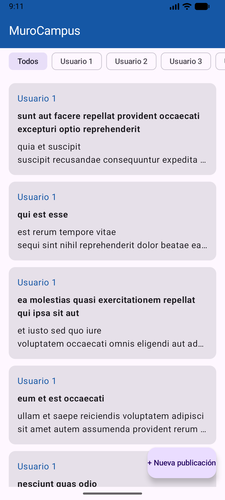
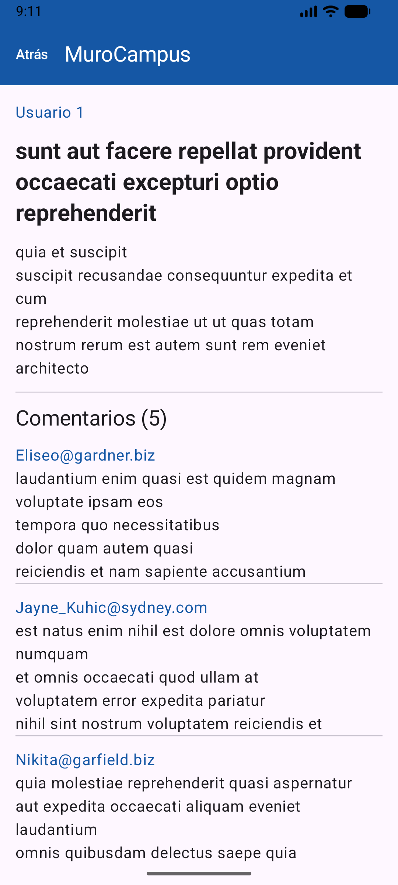
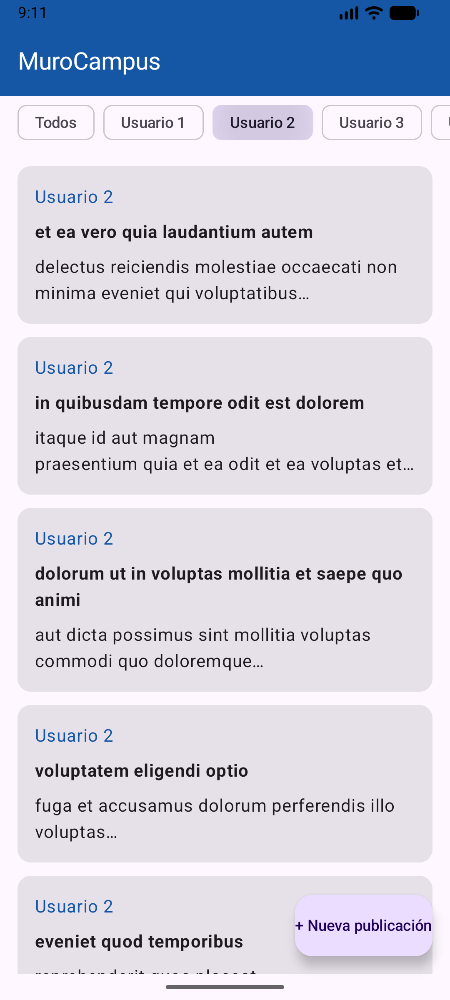
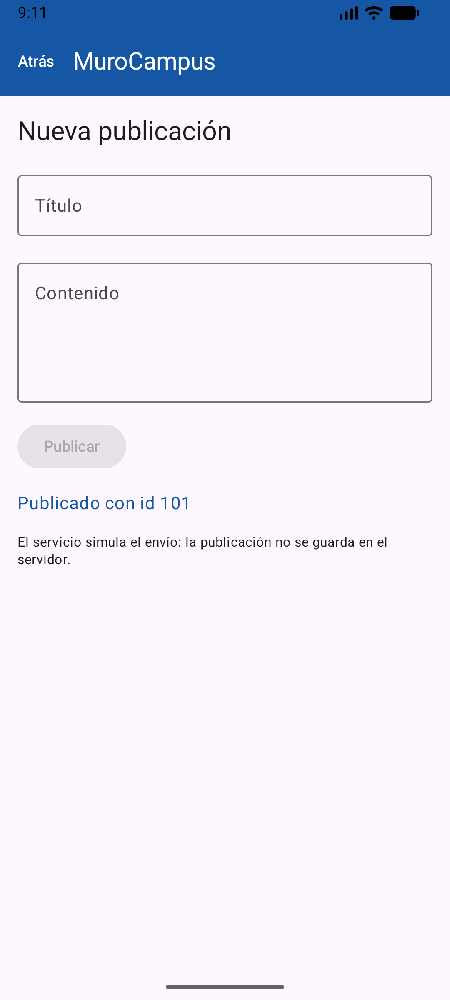
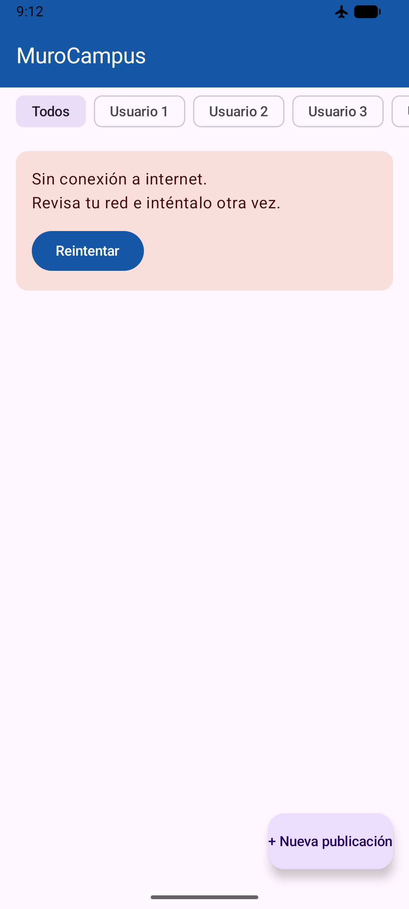

# MuroCampus

Aplicación Android de publicaciones con Kotlin, Jetpack Compose y arquitectura **MVVM + Repository**.
Consulta JSONPlaceholder mediante Retrofit y OkHttp, interpreta JSON con kotlinx.serialization y
expone estados de carga, éxito y error mediante StateFlow.

Proyecto desarrollado desde cero a partir de la plantilla de Android Studio, siguiendo GLAB S09.
Según la aclaración del estudiante, el docente autorizó comenzar desde cero y utilizar IA también
en la primera fase. El paquete se mantiene como `com.clemente.murocampus`.

## Funcionalidades de main

- Listado de publicaciones con estados Cargando, Exito y Error, y botón Reintentar.
- Detalle de una publicación con sus comentarios y navegación de regreso.
- Filtro remoto por usuario (Todos y usuarios 1 a 10).
- Creación de una publicación con validación y confirmación del identificador recibido.
- Mensajes de error de conexión, HTTP y deserialización; cancelación cooperativa de corrutinas.

**JSONPlaceholder simula las escrituras:** crear devuelve normalmente id 101, pero no persiste
la publicación. Por eso no se añade a la lista como si existiera realmente en el servidor.
No hay caché offline: sin internet se muestra un error con reintento.

## Estructura

```text
app/src/main/java/com/clemente/murocampus/
├── MainActivity.kt                 # Ensambla dependencias y navegación
├── model/
│   └── Modelos.kt                  # Post, Comentario, NuevoPost
├── data/
│   ├── PostRepository.kt          # Contrato, implementación remota y traducción de errores
│   └── remote/
│       ├── PostApi.kt              # GET, POST, Path, Query, Body
│       └── RetrofitClient.kt       # HTTPS, JSON y logging solo en debug
├── viewmodel/
│   ├── UiState.kt
│   ├── PostsViewModel.kt
│   └── PostsViewModelFactory.kt
└── ui/
    ├── Componentes.kt
    ├── PantallaLista.kt
    ├── PantallaDetalle.kt
    ├── PantallaCrear.kt
    └── theme/
```

## Arquitectura

```text
Pantallas Compose ──eventos──> PostsViewModel ──> PostRepository (interface)
       ↑                            │                     ↑
       └── collectAsStateWithLifecycle / StateFlow        │ implementa
                                                PostRepositoryRemote
                                                         │ Result<T>
                                                      PostApi
                                                         │
                                                 Retrofit + OkHttp
                                                         │ HTTPS
                                                  JSONPlaceholder
```

La UI no llama a la API. El ViewModel depende del contrato del Repository, sin Retrofit,
PostApi, HttpException ni Context. La Activity ensambla las dependencias mediante una fábrica.
El Repository convierte las excepciones en `Result.failure(ErrorDatos)` con un mensaje seguro
y conserva la causa; `CancellationException` se relanza siempre. La traducción de errores se
ubica en datos, no en el ViewModel, para evitar la dependencia HTTP que prohíbe la guía.

## Ejecución y pruebas

Usar Android Studio con el SDK de la configuración del proyecto (compile/target 37, min 24).
El wrapper usa Gradle 9.6.0 y el daemon está configurado para Java 25. No se cambiaron las
versiones originales de AGP, Kotlin ni Compose para copiar las versiones antiguas del PDF.
Configurar la ubicación local del SDK en `local.properties` (no se incluye en Git).

Desde la raíz del repositorio:

```sh
./gradlew :app:assembleDebug :app:testDebugUnitTest :app:lintDebug
./gradlew :app:connectedDebugAndroidTest
./gradlew :app:installDebug
```

Las pruebas JVM cubren modelos, rutas y cuerpo HTTP con MockWebServer, manejo de fallos,
cancelación y estados del ViewModel. No requieren el servicio real.
`FlujoPrincipalTest` es una prueba de integración con el servicio real: necesita emulador o
dispositivo con internet, valida lista, detalle con cinco comentarios, filtro y creación,
y genera capturas dentro de los archivos privados de la app durante su ejecución.

### Verificación realizada el 25 de noviembre de 2026

- Compilación debug y 20 pruebas JVM: correctas, sin fallos.
- Lint debug: sin errores; hay advertencias de versiones y recursos de la plantilla.
- Dos pruebas instrumentadas en Medium Phone API 37.0: correctas.
- Prueba temporal de red: Logcat mostró «Llegaron 100 publicaciones»; se retiró antes del commit.
- Modo avión: mensaje Sin conexión a internet; recuperada la red, Reintentar volvió a cargar la lista.
- HTTP 404, JSON incompleto y cancelación: comprobados en pruebas automatizadas.
- No se afirma haber probado manualmente cada usuario, la rotación o todas las combinaciones de navegación.

## Cinco capturas reales

Tomadas en el emulador con el servicio real durante la Fase 1.

| Lista | Detalle |
| --- | --- |
|  |  |

| Filtro por Usuario 2 | Creación con id 101 |
| --- | --- |
|  |  |



## Para pensar

1. **GET y POST, Body y Query.** GET consulta recursos; POST envía una representación para crear
   o procesar un recurso. `crear` usa `@Body` porque manda el JSON de NuevoPost en el cuerpo.
   `porUsuario` usa `@Query` porque agrega `userId` como parámetro de consulta a la URL.
2. **Ruta `posts`, no `/posts`.** La ruta relativa conserva el camino de la URL base; una barra
   inicial lo reemplaza desde la raíz del host. Con esta base sin subruta pueden dar la misma
   URL, pero la relativa sigue funcionando si más adelante la base incluye, por ejemplo, `/api/`.
3. **Result en el Repository.** Hace explícitos éxito y fallo, mantiene la presentación separada
   de las excepciones de transporte y permite probarla con un Repository falso. La cancelación
   no es un fallo de negocio y debe propagarse.
4. **INTERNET e ignoreUnknownKeys.** Sin el permiso, Android no permite el acceso de red de la app.
   Sin `ignoreUnknownKeys`, un campo JSON desconocido puede causar deserialización fallida.
   Esta opción no permite omitir campos obligatorios que sí exige el modelo: eso sigue fallando.
5. **when sobre UiState.** Una jerarquía sellada expresa estados mutuamente excluyentes y permite
   un `when` exhaustivo. Tres booleanos independientes pueden representar combinaciones incoherentes,
   como mostrar carga y éxito simultáneamente.
6. **Servicio real.** La publicación creada se guardaría y podría recuperarse con nuevas consultas.
   Actualizaríamos la lista con la respuesta confirmada o la recargaríamos; también habría que
   resolver autenticación, validación de servidor, duplicados, permisos y conflictos según su contrato.

## Git y entrega

### Mejoras en mejora-ia

- **Eliminar publicación:** botón en el detalle con confirmación; usa DELETE y revisa la respuesta
  HTTP en el Repository. Muestra carga, error con reintento o confirmación de eliminación simulada.
  El servicio no guarda el borrado, por eso una nueva consulta puede volver a mostrar la publicación.
- **Búsqueda por título:** filtra localmente sin nuevas peticiones, ignora mayúsculas y espacios
  externos, conserva la consulta al cambiar de usuario y muestra Sin publicaciones si no hay resultados.
- **Encabezado Accept:** interceptor OkHttp que envía `Accept: application/json` en todas las
  peticiones, reemplazando valores anteriores sin duplicados. El logging sigue limitado a debug.
- Las capturas anteriores corresponden a `main`; la rama de mejoras añade el buscador y el botón
  de eliminación. `MejorasTest` cubre esas interacciones con el servicio real.
- El registro de asistencia, adaptaciones y criterio técnico está en `PROMPTS.md`.

**Validación final de mejora-ia (25 de noviembre de 2026):** compilación debug correcta,
27 pruebas JVM y 4 pruebas instrumentadas sin fallos, lint debug sin errores. Las pruebas del
emulador verificaron el flujo original, la búsqueda sin coincidencias y la eliminación con
cancelación/confirmación. Persisten advertencias de versiones y recursos de la plantilla;
no se realizaron actualizaciones de dependencias ajenas al alcance del laboratorio.

`main` contiene los 11 commits secuenciales de la Fase 1. La Fase 2 se desarrolla por separado
en `mejora-ia`. Los commits representan avances reales, no una división posterior de toda la app.
La publicación en GitHub está pendiente: no hay remoto configurado y no se ha ejecutado push.